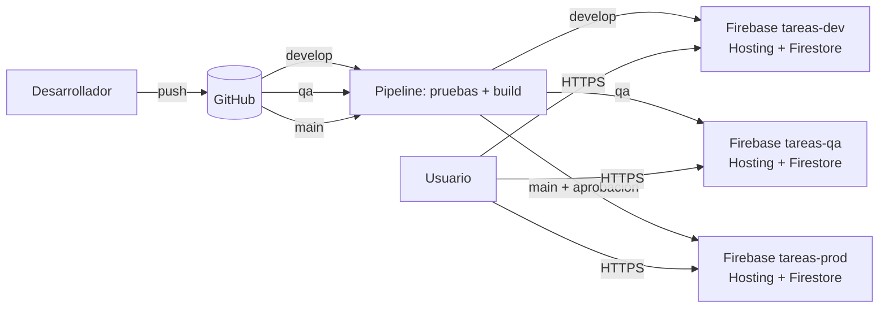

# Tareas — Taller DevOps (Firebase + GitHub Actions)

Aplicación de lista de tareas (React + Vite) con persistencia en Firestore, desplegada en **tres ambientes** (DEV, QA y PDN), cada uno en su propio proyecto de Firebase, con un pipeline en GitHub Actions.

## Arquitectura



| Ambiente | Rama | Proyecto Firebase | URL |
|---|---|---|---|
| DEV | `develop` | `<id>-dev` | `https://<id>-dev.web.app` |
| QA | `qa` | `<id>-qa` | `https://<id>-qa.web.app` |
| PDN | `main` | `<id>-prod` | `https://<id>-prod.web.app` |

No hay API propia: la app habla directo con **Firestore** (servicio administrado), protegido con reglas de seguridad (`firestore.rules`) y sesión anónima. Cada visitante solo ve sus propias tareas.

## Servicios, seguridad y costos

| Servicio | Uso | Seguridad | Costo potencial |
|---|---|---|---|
| Firebase Hosting (x3) | Publica el frontend con HTTPS | HTTPS automático | Plan Spark gratuito (con límites de almacenamiento y transferencia) |
| Cloud Firestore (x3) | Base de datos | Reglas por usuario; no hay endpoint abierto | Gratuito dentro de la cuota diaria de Spark |
| Firebase Auth (anónima) | Identifica al visitante | Sin datos personales | Gratuito |
| GitHub Actions | Pipeline | Secretos y variables por Environment | Gratuito en repos públicos; cuota mensual en privados |

Si algún servicio exige pasar al plan Blaze (de pago), no lo actives: usa solo lo gratuito.

## Puesta en marcha (una sola vez)

### 1. Tres proyectos de Firebase
En [console.firebase.google.com](https://console.firebase.google.com) crea `tareas-<algo>-dev`, `-qa` y `-prod`. En **cada uno**:
1. *Build > Firestore Database > Crear base de datos* (modo producción, cualquier región).
2. *Build > Authentication > Sign-in method > Anónimo > Habilitar*.
3. *Configuración del proyecto > Tus apps > Agregar app web*. Copia `apiKey`, `authDomain`, `projectId` y `appId`.
4. *Configuración del proyecto > Cuentas de servicio > Generar nueva clave privada*. Se descarga un JSON (**no lo subas al repo**).
5. En Google Cloud IAM, a esa cuenta de servicio dale el rol **Firebase Admin** (o "Firebase Hosting Admin" + "Firebase Rules Admin").

Edita `.firebaserc` y reemplaza los tres `REEMPLAZAR-...` por los ID reales de los proyectos.

### 2. Repositorio y ramas
```bash
git init && git add . && git commit -m "Versión inicial"
git branch -M main
git remote add origin https://github.com/<usuario>/tareas-devops.git
git push -u origin main
git checkout -b qa && git push -u origin qa
git checkout -b develop && git push -u origin develop
```

### 3. Environments en GitHub
En *Settings > Environments* crea `dev`, `qa` y `prod`. En cada uno define:

| Tipo | Nombre | Valor |
|---|---|---|
| Variable | `APP_LABEL` | `DEV`, `QA` o `PDN` según el ambiente |
| Variable | `FIREBASE_PROJECT_ID` | ID del proyecto de ese ambiente |
| Variable | `VITE_FIREBASE_API_KEY` | apiKey de ese proyecto |
| Variable | `VITE_FIREBASE_AUTH_DOMAIN` | authDomain de ese proyecto |
| Variable | `VITE_FIREBASE_APP_ID` | appId de ese proyecto |
| **Secret** | `FIREBASE_SERVICE_ACCOUNT` | contenido completo del JSON de la cuenta de servicio |

En el environment `prod` activa **Required reviewers** (agrégate a ti o al docente). Esa es la **aprobación manual** antes de producción.

## Flujo del pipeline

1. `git push` a `develop`, `qa` o `main`.
2. Job `build-test`: `npm ci` y `npm test`. Si falla, **no se despliega nada**.
3. Job `deploy`: compila con las variables del ambiente, despliega Hosting y reglas de Firestore al proyecto correspondiente.
4. Prueba de humo (`scripts/smoke-test.sh`): la URL debe responder 200 y contener la app.
5. Resumen de ejecución con el commit y la URL desplegada (queda como evidencia en la pestaña *Actions*).

Promoción de cambios: `develop` → (merge) → `qa` → (merge/PR) → `main`. En `main` el pipeline se pausa hasta que el revisor apruebe.

```bash
# Ejemplo de promoción
git checkout qa && git merge develop && git push
# Tras validar en QA:
git checkout main && git merge qa && git push   # espera aprobación en GitHub
```

## Correr en tu PC
```bash
cp .env.example .env.local   # completa con los datos del proyecto DEV
npm ci
npm run dev
npm test
```

## Revertir una versión
- Rápido: *Firebase Console > Hosting > Historial de versiones > Revertir* a una versión anterior.
- Por código: `git revert <commit>` en la rama correspondiente; el pipeline vuelve a desplegar.

## Eliminar recursos al finalizar
1. Firebase Console de cada proyecto: *Configuración > General > Eliminar proyecto*.
2. Borra las cuentas de servicio y la clave JSON descargada.
3. GitHub: elimina los Environments y, si quieres, el repositorio.
4. Verifica en Google Cloud que no queden facturaciones activas.
