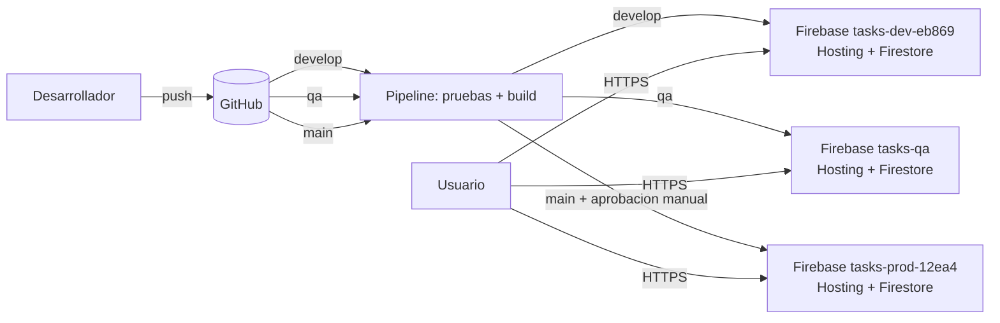

# Tareas — Taller DevOps (Firebase + GitHub Actions)

Electiva: Laboratorio DevOps · Modalidad: proyecto propio

**Integrantes:** Laura Juliana Cárdenas – Edgar David Pérez – Cristian Camilo Osorio – Sergio Cardona Buitrago

Aplicación de lista de tareas (React + Vite) con persistencia en Cloud Firestore, desplegada en **tres ambientes** (DEV, QA y PDN). Cada ambiente vive en su propio proyecto de Firebase y se publica con un pipeline de GitHub Actions.

## URLs de los ambientes

| Ambiente | Rama de Git | Proyecto Firebase | URL de la aplicación | API |
|---|---|---|---|---|
| DEV | `develop` | `tasks-dev-eb869` | https://tasks-dev-eb869.web.app/ | No aplica (Firestore) |
| QA | `qa` | `tasks-qa` | https://tasks-qa.web.app/ | No aplica (Firestore) |
| PDN | `main` | `tasks-prod-12ea4` | https://tasks-prod-12ea4.web.app/ | No aplica (Firestore) |

No hay una API independiente: la aplicación es serverless y habla directamente con **Cloud Firestore** (servicio administrado) mediante el SDK de Firebase. Firestore cumple la función de API y base de datos, y se protege con reglas de seguridad (`firestore.rules`) y sesión anónima, de modo que cada visitante solo ve y modifica sus propias tareas. La base de datos no se expone como endpoint abierto.

**Evidencia de ejecución del pipeline:** https://github.com/Sergiooooooooooooooo/tasks-devops/actions/runs/40643708943 (ejecución exitosa en `main`, con aprobación manual del despliegue a producción). Todas las ejecuciones: https://github.com/Sergiooooooooooooooo/tasks-devops/actions

## Arquitectura



Separación de ambientes: cada ambiente tiene su proyecto de Firebase, su base de datos y su URL. Los datos de DEV y QA nunca se mezclan con los de producción. La configuración de cada uno (ID del proyecto, claves públicas de la app web y clave de despliegue) se guarda en un **Environment** de GitHub (`dev`, `qa`, `prod`), no en el código.

## Servicios, seguridad y costos

| Servicio | Uso | Seguridad | Costo potencial |
|---|---|---|---|
| Firebase Hosting (x3) | Publica el frontend con HTTPS | HTTPS automático | Plan Spark gratuito (con límites de almacenamiento y transferencia) |
| Cloud Firestore (x3) | Base de datos, una por ambiente | Reglas por usuario; sin endpoint abierto | Gratuito dentro de la cuota diaria de Spark |
| Firebase Authentication (anónima) | Identifica al visitante sin datos personales | Cada sesión solo accede a sus documentos | Gratuito |
| GitHub Actions | Pipeline CI/CD | Secretos y variables por Environment; la clave de despliegue nunca está en el repositorio | Gratuito en repositorios públicos |

Costo esperado: **$0**. Los proyectos usan el plan Spark; no se debe activar el plan Blaze (de pago).

Seguridad adicional:
- El repositorio no contiene credenciales: `.gitignore` excluye `.env*` y `sa.json`, y la clave de la cuenta de servicio se guarda como *secret* en GitHub.
- El despliegue a producción exige aprobación manual (*Required reviewers* en el Environment `prod`).

## Flujo del pipeline

1. `git push` a `develop`, `qa` o `main`.
2. Job `build-test`: `npm ci` y `npm test`. Si falla, **no se despliega nada**.
3. Job `deploy`: compila con las variables del ambiente y despliega Hosting y reglas de Firestore al proyecto correspondiente.
4. Prueba de humo (`scripts/smoke-test.sh`): la URL debe responder 200 y contener la aplicación.
5. Resumen de la ejecución con el commit y la URL desplegada (queda en la pestaña *Actions*).

| Evento | Acción | Destino |
|---|---|---|
| Push a `develop` | Pruebas, build, despliegue y prueba de humo | DEV |
| Merge de `develop` a `qa` | Pruebas, build, despliegue y prueba de humo | QA |
| Merge de `qa` a `main` | Pruebas, build, **aprobación manual**, despliegue y prueba de humo | PDN |

Promoción de cambios:

```bash
git checkout develop && git push           # despliega a DEV
git checkout qa && git merge develop && git push     # despliega a QA
git checkout main && git merge qa && git push        # espera aprobación y despliega a PDN
```

## Puesta en marcha (una sola vez)

### 1. Tres proyectos de Firebase
En [console.firebase.google.com](https://console.firebase.google.com) se crean los proyectos de DEV, QA y PDN. En **cada uno**:
1. *Build > Firestore Database > Crear base de datos* (modo producción).
2. *Build > Authentication > Sign-in method > Anónimo > Habilitar*.
3. *Configuración del proyecto > Tus apps > Agregar app web*. Se copian `apiKey`, `authDomain`, `projectId` y `appId`.
4. *Configuración del proyecto > Cuentas de servicio > Generar nueva clave privada* (JSON, **no se sube al repositorio**).
5. En Google Cloud IAM, a esa cuenta de servicio se le asignan los roles **Firebase Admin** y **Service Usage Admin**. Sin ellos el despliegue falla con un error 403 de permisos.

Los ID de los proyectos se definen en `.firebaserc`.

### 2. Repositorio y ramas
```bash
git init && git add . && git commit -m "Versión inicial"
git branch -M main
git remote add origin https://github.com/Sergiooooooooooooooo/tasks-devops.git
git push -u origin main
git checkout -b qa && git push -u origin qa
git checkout -b develop && git push -u origin develop
```

### 3. Environments en GitHub
En *Settings > Environments* se crean `dev`, `qa` y `prod`. En cada uno se definen:

| Tipo | Nombre | Valor |
|---|---|---|
| Variable | `APP_LABEL` | `DEV`, `QA` o `PDN` según el ambiente |
| Variable | `FIREBASE_PROJECT_ID` | ID del proyecto de ese ambiente |
| Variable | `VITE_FIREBASE_API_KEY` | apiKey de ese proyecto |
| Variable | `VITE_FIREBASE_AUTH_DOMAIN` | authDomain de ese proyecto |
| Variable | `VITE_FIREBASE_APP_ID` | appId de ese proyecto |
| Secret | `FIREBASE_SERVICE_ACCOUNT` | contenido completo del JSON de la cuenta de servicio |

En el Environment `prod` se activa **Required reviewers**: esa es la aprobación manual antes de producción.

## Correr en local
```bash
cp .env.example .env.local   # completar con los datos del proyecto DEV
npm ci
npm run dev
npm test
```

## Revertir una versión
- Rápido: *Firebase Console > Hosting > Historial de versiones > Revertir* a una versión anterior del ambiente afectado.
- Por código: `git revert <commit>` en la rama correspondiente; el pipeline vuelve a desplegar esa versión.

## Procedimiento para desactivar o eliminar recursos al finalizar

Al terminar el taller se retiran los recursos para evitar consumo y cargos inesperados. Se puede **desactivar** (pausar sin borrar, para poder reactivar) o **eliminar** (borrado definitivo).

### A. Desactivar (reversible)
1. **Pipeline:** en GitHub, *Actions > Pipeline DEV, QA y PDN > menú ⋯ > Disable workflow*. Así ningún push vuelve a desplegar.
2. **Sitios publicados:** para cada proyecto, con Firebase CLI: `firebase hosting:disable --project <ID del proyecto>`. La URL deja de mostrar la aplicación; los datos de Firestore se conservan.

### B. Eliminar (definitivo)
1. **Proyectos de Firebase** (`tasks-dev-eb869`, `tasks-qa`, `tasks-prod-12ea4`): en Firebase Console de cada uno, *Configuración del proyecto > General > Eliminar proyecto*. Esto borra Hosting, Firestore, Authentication y las cuentas de servicio asociadas. Google conserva el proyecto un tiempo en estado de recuperación antes de borrarlo del todo.
2. **Claves de despliegue:** borrar de los equipos los archivos JSON descargados (`clave-dev.json`, `clave-qa.json`, `clave-prod.json`).
3. **GitHub:** en *Settings > Environments* eliminar `dev`, `qa` y `prod` (esto borra sus variables y secretos). Opcionalmente, eliminar el repositorio en *Settings > General > Danger Zone*.
4. **Verificación:** confirmar que las tres URLs ya no responden, que ningún proyecto tiene una cuenta de facturación asociada y que no se activó el plan Blaze.
